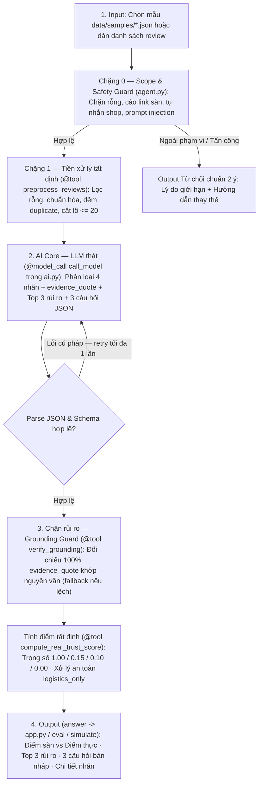

# SPEC — Đặc Tả Hệ Thống AI: ReviewShield

> Lộ trình mốc: Chốt `§7` trước CP2 (19:30 Thứ Sáu 27/11) • Nộp `§0–§7` tại CP3 (10:00 Thứ Bảy 28/11) • Đủ `§0–§10` tại CP4 (14:30 Thứ Bảy 28/11).

## §0. Bối cảnh & Bài toán hiện tại
Người mua hàng trên các sàn thương mại điện tử thường dựa vào điểm sao hiển thị (4.8–5.0 sao) để quyết định nhanh. Thực tế, điểm này thường bị bóp méo bởi đánh giá nhận xu ("giao nhanh, chưa dùng nhưng cho 5 sao"), đánh giá lặp mẫu nghi vấn seeding và đánh giá 1–2 sao chỉ phàn nàn về shipper.

## §1. Người dùng mục tiêu & Bằng chứng Pain
* **Người dùng chính:** Người mua hàng online phổ thông cần thẩm định nhanh độ tin cậy của sản phẩm trước khi đặt mua.
* **Bằng chứng pain:** Tổng hợp từ dữ liệu đào review công khai (`evidence/data-mining.md`), phỏng vấn người mua (`evidence/interviews/`) và khảo sát (`evidence/survey/`), xem chi tiết tại `evidence/summary.md`.

## §2. Giải pháp & Lát cắt MVP
**ReviewShield** nhận một cụm đánh giá sản phẩm (từ kho 25–30 mẫu thật đã ẩn danh hoặc người dùng dán trực tiếp), thực hiện:
1. Tiền xử lý loại bỏ review trống và đếm số lượng review trùng lặp hoàn toàn.
2. Gọi mô hình ngôn ngữ thật (Structured Output JSON) để phân loại từng review vào 1 trong 4 nhãn tín hiệu (`verified_insight`, `low_signal`, `suspicious_pattern`, `logistics_only`) kèm trích dẫn nguyên văn `evidence_quote`.
3. Chạy lớp **Grounding Guard** kiểm chứng 100% trích dẫn phải xuất hiện trong review gốc.
4. Tính **Điểm tin cậy thực (Real Trust Score)** bằng công thức trọng số tất định, tổng hợp Top 3 rủi ro thực tế từ nhóm `verified_insight` và sinh 3 câu hỏi kiểm chứng shop.

## §3. Phạm vi Không làm (Out of Scope)
* Không xây crawler phía server tự động cào link Shopee/TikTok Shop (tránh captcha và rủi ro sập demo).
* Không phán quyết tuyệt đối "review giả 100%".
* Không tự gửi tin nhắn tới shop hoặc can thiệp trực tiếp vào tài khoản sàn của người dùng.

## §4. Kiến trúc luồng & Ánh xạ vào `codebase/`

### Sơ đồ kiến trúc AI (`Input → AI Core → Chặn rủi ro → Output`)

### Ánh xạ vào `codebase/`
* `codebase/ai.py`: Cài đặt `call_model(system, user)` nối API LLM thật (theo `docs/connect-model.md`), giữ nguyên `@model_call` và trả về đúng `text`, `model`, `tokens_in`, `tokens_out`.
* `codebase/tools.py`: Khai báo các `@tool` gồm `preprocess_reviews`, `verify_grounding`, `compute_real_trust_score` (tất định 100%, không giao phép tính cho LLM).
* `codebase/agent.py`: Hàm `answer(text)` nhận đầu vào review (JSON hoặc text), gọi các tool và `call_model`, tổng hợp câu trả lời có cấu trúc rõ ràng kèm bảng Điểm sàn vs Điểm thực, Top 3 rủi ro, 3 câu hỏi kiểm chứng và chi tiết nhãn từng review.
* `codebase/app.py`: Giao diện web 1 màn hình phục vụ demo trực tiếp.

## §5. Đặc tả Prompt, Nhãn & Công thức Điểm
Chi tiết đầy đủ nằm tại `docs/AI_PROMPT_AND_SCORING.md`. Tóm tắt trọng số chất lượng:
* `verified_insight` (Trải nghiệm cụ thể): trọng số `1.00`
* `low_signal` (Nhận xu / Thiếu thông tin): trọng số `0.15`
* `suspicious_pattern` (Nghi vấn lặp mẫu): trọng số `0.10`
* `logistics_only` (Lỗi vận chuyển): trọng số `0.00` (tách riêng cảnh báo vận chuyển)

## §6. Quản trị rủi ro & An toàn
* **Rủi ro AI bịa trích dẫn:** Chặn bằng `verify_grounding` trong `codebase/tools.py`.
* **Rủi ro AI tính sai điểm:** Chặn bằng `compute_real_trust_score` tính hoàn toàn bằng Python.
* **Rủi ro lộ dữ liệu cá nhân:** Toàn bộ dữ liệu mẫu đều ẩn danh người viết thành `user_01`, `user_02`.

## §7. Chuẩn "Đạt" (Khóa trước CP2 — khớp `eval/metric_spec.yaml`)
Hệ thống đạt chuẩn phát hành MVP khi chạy `python run.py eval` trên bộ `eval/benchmark.csv` (>= 25 tình huống thật, đủ 4 nhóm kịch bản) thỏa mãn đồng thời 4 ngưỡng (và điều kiện kỹ thuật `schema_compliance = 100%` không vỡ định dạng JSON):
1. **`label_accuracy` >= 85%**: Tỷ lệ phân loại đúng nhãn 4 nhóm so với nhãn chuẩn.
2. **`direction_match` >= 85%**: Tỷ lệ case dự đoán đúng chiều biến động của Điểm tin cậy thực so với điểm sàn (`near_platform`, `lower_than_platform`, `higher_than_platform`).
3. **`citation_grounding` = 100%**: Mọi `evidence_quote` hiển thị cho người dùng phải khớp nguyên văn chuỗi con trong review gốc.
4. **`actionable_quality` >= 80%**: Đánh giá bởi người chấm xem Top 3 rủi ro và 3 câu hỏi kiểm chứng shop có sát với phàn nàn thực tế trong cụm review hay không.

## §8. Kết quả đánh giá thực tế (CP3–CP4 · Model `gemini-3.5-flash-lite`)
* **Lượt 1 (`run-1@20261127-184552`):** `10/30` câu đạt (`33%`: `thuong` 5/21, `kho` 2/6, `tu_choi` 3/3); `citation_grounding` **100,0%** (305/305), `direction_match` **88,5%** (23/26), `label_accuracy` **71,0%** (225/317), 1 lỗi kỹ thuật HTTP 503 tại `RS08`.
* **Lượt 2 (`run-2@20261128-073745` — sau cải tiến Prompt v2 + retry backoff 3 lần):** `13/30` câu đạt (`43%`: `thuong` 6/21, `kho` **4/6 [67%]**, `tu_choi` **3/3 [100%]**); **0 lỗi kỹ thuật**; `citation_grounding` **100,0%** (317/317 — đạt), `direction_match` **92,3%** (24/26 — đạt, +3,8%), `label_accuracy` **79,8%** (253/317 — tăng **+8,8%**, riêng `RS28` từ 2/12 → 9/12, `RS30` từ 0/12 → 6/12). Chi tiết so sánh tại `eval/report.md`.

## §9. Ước tính chi phí vận hành (CP4 · `simulate-1@20261128-123636`, 50 phiên, seed 42, `--rate-from eval/run-2.csv` [43%])
* **Model chính (`gemini-3.5-flash-lite`, đo token thật):** `$0.0069`/phiên (≈ 177 ₫) · **`$0.0160`/task thành công (≈ 407 ₫)** · Chi phí/tháng: thấp (300 người) `$28.17` (718k ₫) · cơ sở (700 người) `$65.72` (1,68 triệu ₫, tức **2.394 ₫/người/tháng**) · cao (1.000 người) `$93.89` (2,39 triệu ₫).
* **Model đối chiếu (`gemini-3.1-pro-preview`):** `$0.0353`/phiên (≈ 900 ₫) · `$0.0814`/task thành công (≈ 2.076 ₫) · cơ sở (700 người) `$335.15`/tháng (12.209 ₫/người/tháng). Chi tiết xem `cost/cost-estimate.md` và `cost/simulate-1-summary.md` (ghi nhận trung thực 6/50 phiên lỗi HTTP 503 không tính vào trung bình).

## §10. Nhật ký thay đổi (Changelog — cập nhật đến 23:59 Thứ Bảy 28/11)
* **2026-11-27 (CP1–CP2):** Khởi tạo đặc tả ReviewShield (Track D), bổ sung sơ đồ kiến trúc AI (`§4`), chốt khóa 4 ngưỡng đạt (`§7` khớp `eval/metric_spec.yaml`), hoàn thiện lõi `ai.py`, `agent.py`, `tools.py` và 14 câu benchmark CP2.
* **2026-11-27 (CP3):** Mở rộng bộ đánh giá lên 30 câu thật (26 SP Shopee + Điện Máy Xanh, `kho: 6`, `tu_choi: 3`), hoàn thiện bằng chứng 2 nguồn (`evidence/data-mining.md` + phỏng vấn `P1–P3`), UI Streamlit (`codebase/app.py`), và chạy Eval Lượt 1 (`run-1@20261127-184552`, `gemini-3.5-flash-lite`: 10/30 câu đạt, `citation_grounding` 100%, `direction_match` 88,5%, `label_accuracy` 71,0%, 1 lỗi HTTP 503 tại `RS08`).
* **2026-11-28 (CP4 — Cải tiến & Eval Lượt 2, Bảo & Khanh):** Đọc toàn bộ 20 câu trượt ở `eval/run-1.csv` (lỗi tập trung ở `suspicious_pattern` chỉ đúng 6/48: 24 nhầm `verified_insight`, 12 `low_signal`, 6 `logistics_only`; và 32 ca nhầm ranh giới `verified_insight` ↔ `low_signal`). Thực hiện cải tiến: (1) Nâng retry exponential backoff 3 lần (`2s → 4s → 8s`) cho HTTP 429/503 trong `codebase/ai.py` (PR #8); (2) Nâng cấp System Prompt v2 trong `codebase/agent.py` (tổng quát theo quy ước ranh giới, không hardcode benchmark) bổ sung thứ tự ưu tiên phân định 4 nhãn. Chạy & chấm Lượt 2 (`run-2@20261128-073745`): **0 lỗi kỹ thuật**, `13/30` đạt (`43%`), `kho` `4/6 (67%)`, `label_accuracy` **71,0% → 79,8%** (+8,8%), `direction_match` **88,5% → 92,3%** (+3,8%), `citation_grounding` **100,0%**.
